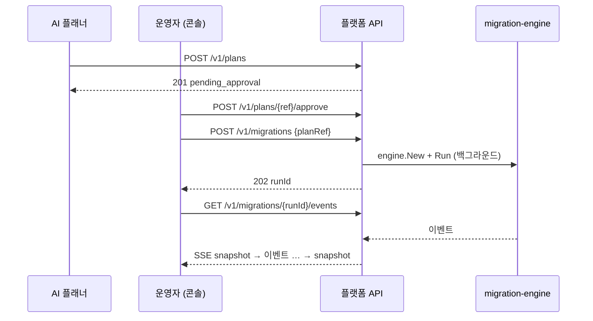

# platform

HopCharlie 플랫폼 서버입니다. 바이너리 두 개로 이루어져 있습니다.

```
platform/
├── cmd/api/        플랫폼 API: Plan 접수 · 사람 승인 · 이전 실행 · 이벤트 스트림
├── cmd/gateway/    트래픽 게이트웨이 (아직 스텁: 모든 요청에 501)
└── internal/
    ├── api/        HTTP 핸들러, 인증, 오류 형식, SSE
    ├── plans/      Plan 저장, 승인 상태, 보안 정책
    └── runs/       migration-engine 실행, 이벤트 전달
```

## 흐름



## API

모든 `/v1` 요청에는 `Authorization: Bearer $PLATFORM_API_TOKEN`이 필요합니다.

| 요청 | 설명 |
| --- | --- |
| `POST /v1/plans` | 엔진 Plan JSON을 그대로 보냅니다. 보안 정책 검사 후 `pending_approval`로 저장합니다 |
| `GET /v1/plans`, `GET /v1/plans/{ref}` | Plan 요약을 봅니다. DSN과 토큰은 응답에 절대 들어가지 않습니다 |
| `POST /v1/plans/{ref}/approve` | 사람이 승인합니다 |
| `POST /v1/migrations` `{"planRef": "..."}` | 승인된 Plan을 실행합니다. **202 + runId**를 돌려주며, 완료를 뜻하지 않습니다. `Idempotency-Key` 헤더를 붙이면 재시도해도 같은 run을 돌려줍니다 |
| `GET /v1/migrations`, `GET /v1/migrations/{runId}` | 엔진 상태를 그대로 돌려줍니다(`outcome`: running / succeeded / rolled_back / halted / failed) |
| `GET /v1/migrations/{runId}/events` | SSE. 첫 메시지는 `snapshot`(전체 상태), 다음부터 엔진 이벤트, 끝나면 마지막 `snapshot` 후 종료 |

오류는 항상 `{"error": {"code": "...", "message": "..."}}` 형식입니다.

| 코드 | 상태 | 뜻 |
| --- | --- | --- |
| `unauthorized` | 401 | 토큰이 없거나 틀림 |
| `invalid_request`, `invalid_plan` | 400 | 요청 형식 오류, Plan 검증 또는 보안 정책 위반 |
| `plan_not_found`, `run_not_found` | 404 | 없음 |
| `plan_state_conflict` | 409 | 아직 승인 안 됨, 또는 이미 실행됨 |
| `cluster_busy` | 409 | 같은 클러스터에서 다른 이전이 진행 중 |
| `idempotency_key_reused` | 409 | 같은 키를 다른 Plan에 사용 |
| `engine_init_failed` | 502 | 엔진 생성 실패 (예: 없는 kube context) |

SSE에는 재접속 재개(Last-Event-ID)가 없습니다. 엔진 이벤트에 번호가 없기 때문입니다. 다시 접속하면 새 snapshot부터 받습니다.

## 보안 정책 (`internal/plans/policy.go`)

엔진은 Plan 안의 `${VAR}`를 **서버 환경 변수로 치환**하고, Plan에 적힌 파일 경로를 읽고 프로그램을 실행합니다. 그래서 API는 Plan을 받기 전에 다음을 막습니다.

- 허용 목록에 없는 환경 변수 참조 (기본: `SRC_PGPASSWORD`, `DST_PGPASSWORD`, `GATEWAY_TOKEN`)
- `kubeconfig` 지정, `files.rclone` 바이너리 지정, 허용되지 않은 rclone 플래그
- 절대 경로이거나 `..`로 빠져나가는 `target.manifest` / `verify.writtenRecords`
- 플랫폼 게이트웨이가 아닌 `gateway.url`, 허용 도메인 밖의 DB 호스트 (설정한 경우)

## 실행

엔진 레포가 private이라 Go 모듈을 받으려면 한 번 설정이 필요합니다.

```bash
go env -w GOPRIVATE=github.com/2026-Softbank-Hackathon-Charlie

export PLATFORM_API_TOKEN=...            # 필수 (로컬 개발은 -insecure-no-auth)
export SRC_PGPASSWORD=... DST_PGPASSWORD=...
go run ./cmd/api -addr :8080
go run ./cmd/gateway -admin-addr :9901
```

| 환경 변수 | 설명 |
| --- | --- |
| `PLATFORM_API_TOKEN` | 운영자 토큰 |
| `PLATFORM_ADDR`, `PLATFORM_STATE_DIR` | 주소(기본 `:8080`), 엔진 상태 디렉터리 |
| `PLATFORM_PLAN_ENV_ALLOW` | Plan이 참조할 수 있는 환경 변수 (쉼표 구분) |
| `PLATFORM_GATEWAY_URL` | 허용할 게이트웨이 주소. 비우면 `gateway.mode: http`를 거부 |
| `PLATFORM_DSN_HOST_SUFFIXES` | 허용할 DB 호스트 접미사 (예: `.ts.net`) |

서버를 끌 때는 진행 중인 이전이 끝날 때까지 기다립니다(`-shutdown-wait`, 기본 15분). 그래도 안 끝나면 취소하고, 이후 처리는 엔진 규칙을 따릅니다(승격 전이면 원복, 승격 후면 정지).

## 아직 없는 것
- 저장소: Plan과 run 목록이 메모리에만 있습니다. 재시작하면 목록이 사라집니다(엔진 상태 파일은 남습니다). 팀 문서대로 PostgreSQL로 옮겨야 합니다.
- 인증: 토큰 하나뿐입니다. 사용자 구분과 역할(AI는 제출만, 운영자만 승인)이 없습니다. 브라우저 `EventSource`는 헤더를 못 붙이므로 콘솔용 인증 방식도 정해야 합니다.
- 실행 중인 이전을 멈추는 API, 환경과 앱 목록 API
- 게이트웨이 본체 (C 영역)
