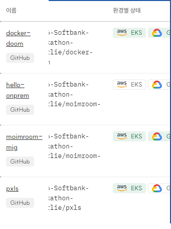
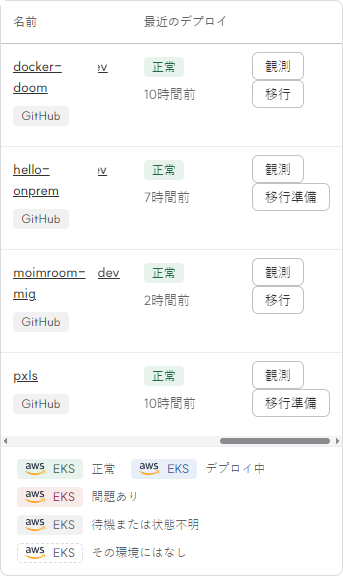
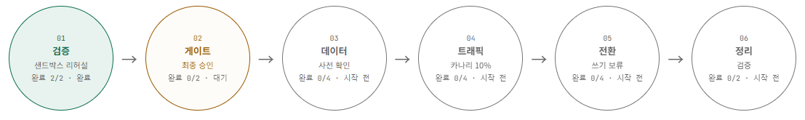

# 2026-11-08 종합 E2E 검증 기록

상태: **검증 완료 — 최종 운영 브라우저 10개, 격리 DB 파이프라인 4개, 실제 원격 파일 10개 시나리오 통과**. 운영 기능 활성화 범위는 아래 별도로 표시한다. 최초 모바일 실패는 frontend #117 수정·배포 후 실제 화면에서 해소됐으며 원래 실패 기록도 보존한다.

아래 artifact 시각은 UTC이며 한국 시각은 9시간을 더한다. 검증 파일 자체는 `python docs/e2e/2026-11-08/verify-record.py`로 네트워크 없이 JSON·내용 hash·측정 범위·credential 패턴을 확인한다. 사본 hash는 플랫폼의 줄바꿈 변환과 구분하도록 UTF-8/LF 기준이며 원본 byte hash도 별도로 보존한다.

## 범위와 기준

운영에서는 기존 operator 인증을 RAM에만 유지한 새 headless Chrome으로 실제 콘솔과 읽기 전용 API를 확인했다. 이전·계획 생성·승인·GPU 카나리·인프라 변경 요청은 보내지 않았다. 예외적으로 정상 개요 진입에 의한 추천 작업을 한 번 허용했으며, 그 작업의 agent session·결과 callback 기록은 정상 기능의 일부다. 이후 확인은 새 AI 작업을 만들지 않는 캐시 상태 GET이다. HAR, Playwright trace, 원문 로그·프롬프트·응답 본문·인증 헤더·브라우저 storage-state는 보관하지 않았다.

DB 장애 주입·이전·복구와 파일 변조·역방향 복사는 운영과 분리한 실제 임시 컴포넌트에서 실행했다. DB와 파일 시험은 **독립 실행**이며 DB·파일을 한 앱에서 함께 옮긴 단일 실행이나 AWS↔GCP↔실제 노트북 이전 성공으로 합산하지 않는다. unit/HTTP fixture, 실제 브라우저+통제 데이터, 실제 임시 컴포넌트, 운영 읽기 전용 확인을 구분한다.

## 실행 결과와 운영 범위

| 항목 | 실제 결과 | 시험 판정 | 운영 기능 범위·한계 |
| --- | --- | --- | --- |
| API 운영 이미지 | `a89634a-minio@480198…`, Ready 1, generation/observedGeneration 99/99 | PASS | 기본 이미지로 바꾸지 않고 기존 MinIO 빌드 유지. [rollout](evidence/runtime-rollout.json) |
| 콘솔 최종 운영 이미지 | `eb9cc64@c91920…`, Ready 1, generation/observedGeneration 82/82 | PASS | 기대 이미지 문자열과 실제 Deployment 메타데이터를 구분. [실측 rollout](evidence/console-final-rollout.json) |
| 공개 health·설치 스크립트 | 200, 200. 스크립트 8,348바이트 SHA256이 해당 Git blob과 일치 | PASS | `--install-k3s` 지원 확인만. 스크립트 실행·등록 코드 발급·실제 재설치는 하지 않음. [증거](evidence/public-probes.json) |
| 운영 앱 목록·온프렘 선택 | 실제 앱 4개, docker-doom 대상의 onprem 선택 가능 | PASS | Plan 생성·이전 실행은 하지 않음. 실행 전 지도 미표시는 기록하되 DB 없는 실제 이전 지도를 검증했다고 주장하지 않음 |
| 운영 관측 창 | 앱 범위 AI/LLM/HyperDX GET 200, Langfuse `not_configured` 표시 | 표시 검증 PASS | **LLM 관측 연동은 미설정**. `serviceCount=0`·미관측은 AI 미사용이나 요청 0건의 증명이 아님. [재검증](evidence/browser-focused.json) |
| 운영 추천 AI | UI 진입 1회 → ready, 카드 4개. 기존 모델 `claude-sonnet-5-5`, 정확한 explain session의 toolCalls 1 | PASS | 추천 Job 1개. 모델 API 호출 횟수·비용·절감액·응답 품질은 측정하지 않음. 도구 호출 1건을 모델 API 호출 1건으로 바꾸어 해석하지 않음 |
| 추천 캐시 | 다음 확인 전 버튼 잠금, 명시적인 저가 status GET으로 결과 확인 | PASS | 자동 이전 없음. 최초 empty-cache `/status: not_configured`를 runner 설정 부재로 단정하지 않음 |
| 온프렘 표준 수집 설정 | observability namespace 없음, hello-onprem/moimroom-mig Deployment의 OTEL 변수 각각 0개 | 설정 부재 확인 PASS | **표준 수집기 미설치, 중앙 수신량 미측정**. 비표준 경로나 SDK 자체 전송까지 부재라고 단정하지 않음. [증거](evidence/onprem-configuration.json) |
| 모바일 앱 목록 | 390px viewport에서 문서·body·client 폭 모두 375px. fresh/resize, KO/JA, 키보드 스크롤 0→40px, 숨긴 label 12개 모두 표 내부 | 최종 PASS | 최초 434px/fresh 422px 실패 보존. [실패 진단](evidence/browser-scroll-diagnostic.json), [수정 후 실제 운영](evidence/browser-final.json) |
| 결과·AI 활동·환경·이전 지도 | 결과 지표 6개와 펼침/접힘, 앱/From/To 헤더, DB·백업 목록 각 4개, 기존 지도 단계 6개 | PASS | 미측정 지표 1개·미확인 context 83개를 그대로 표시. 기존 대기 Plan의 지도 DOM 확인이며 새 Plan·이전을 실행하지 않음 |
| 임시 DB 전체 이전 | API→승인 Plan→엔진→CNPG primary/replica→HTTP gateway+부하, 4개 시나리오 | PASS | 임시 환경. 클라우드 네트워크·운영 이전·파일 동시 이전은 미검증 |
| 실제 MinIO·rclone | 독립 MinIO 두 대, 실제 rclone, 필수 10개 시나리오 | PASS | 파일 경로만 시험. DB와 파일 단일 실행·운영 버킷·실제 클라우드 IAM은 미검증 |
| 온보딩 반응형 UI | 실제 로컬 Chrome, KO/JA·desktop/mobile·키보드·diff 스크롤 | PASS | 통제된 UI 데이터의 검증. 운영 앱 가져오기 실행이 아님. [기존 증거](evidence/onboard-local-ui.json) |

운영 추천의 생성 시각은 19:08:15 UTC이고, 19:08:40 UTC 상태 조회에서 ready 4개를 확인했다. 이는 조회 간격을 포함한 관측이며 모델 처리 시간이나 이전 지연시간 benchmark가 아니다. [초기 브라우저](evidence/browser-initial.json), [완료 후 캐시·모델·세션 메타데이터](evidence/browser-all-fonts.json), [Job metadata](evidence/recommendation-jobs.json)를 함께 읽는다.

## 최종 운영 브라우저 재검증

최종 실행은 19:37:59.941–19:38:26.926 UTC, Chrome `157.0.8103.38`이다. [frontend #117](https://github.com/2026-Softbank-Hackathon-Charlie/frontend/pull/117)의 CI 715개 테스트와 build 통과 후 배포된 `eb9cc64f93aa74499a716e61b700769166e584de`를 사용했다. 새 추천 진입 0회, mutation 시도 0회, uncaught page error 0건, browser close·native Storage credential 없음이 확인됐다. 최종 실행에서 허용하지 않은 원문 event/log 등 GET 14건은 하네스가 차단했으며 해당 내용 검증은 범위 밖이다. 이 차단을 제품 API 실패로 집계하지 않는다.

실행 순서는 공개 인증 화면 → 실제 앱 목록 → moimroom 관측 상태 → 환경 메타데이터 → docker-doom 대상 선택 → 모바일 fresh/resize·키보드·일본어 → 이전 결과 상세 토글 → AI 활동 context 헤더 → DB/백업 목록 → 기존 moimroom 지도다. 운영 사용자 인증·계획 생성·승인·이전 버튼은 누르지 않았다. 환경 표의 전체 상태를 통과시킨 것이 아니라 해당 GET과 DB/백업 표시를 확인했으며, `온프레미스` 문자열 검색 결과가 false였던 항목도 원본 JSON에 남긴다. 온프렘 대상 선택 가능 여부는 별도 selector에서 실제 `onprem` enabled로 확인했다.

모바일 실패 원인은 표 밖을 기준으로 배치된 접근성용 `.sr-only`였다. scoped containing block 수정 후 document 폭은 375px이며, 표 자체의 가로 콘텐츠 939px는 341px 영역 안에서 스크롤된다. native scrollbar를 숨기는 headless 기본 인자를 제거하고 실제 bar를 확인했다. 일본어에서 언어 전환 버튼과 마지막 행 action의 겹침은 0개다. 화면 전체 overflow를 숨겨 실패를 가린 것이 아니다.

지도는 원안 제목(검증·게이트·데이터·트래픽·전환·정리), 현재 내부 단계, 상태를 모두 표시했다. 최종 승인 대기 중인 기존 상태를 읽었으며 진행 애니메이션 전체나 새 이전 완료를 재현한 것은 아니다.

## 실제 임시 DB 파이프라인

[실행 42404334635](https://github.com/2026-Softbank-Hackathon-Charlie/platform/actions/runs/42404334635), 제품 소스 `a89634a66bd7bac45efdc3facf556e6feadcb3b2`, workflow `078cea9193e218b0314987668f7db6f96c7baedf`. 실행 구간: 2026-11-07 19:03:50.368–19:11:13.369 UTC. 사용한 엔진 제품 코드는 `3ede4a44f3b1`이다. 이후 engine #31은 보호 정책·문서 변경이며 Go 코드 변경이 아니므로 runtime pin 불일치로 취급하지 않는다.

| 시나리오 | 실측 결과 |
| --- | --- |
| 응답 유실 후 재시도 | 성공 쓰기 931, 최초 실패 149, 복구된 쓰기 149, 재시도 155, 최종 실패 0 |
| 카나리 장애 | rolled_back, 성공·재확인 쓰기 각각 5,560, 최종 실패 0 |
| 관찰 뒤 역방향 복구 | 시나리오 PASS, 원실행 succeeded, 성공·재확인 각각 1,417. 원실행을 rolled_back으로 표시하지 않음 |
| 정상 이전 | succeeded, 성공·재확인 각각 3,217, 검증 창 checked_writes 2,794, missing_rows 0, missing_writes 0 |

최종 성공 쓰기는 합계 11,125건이다. 의도한 최초 요청 실패 149건이 있었으므로 이를 “실패 요청 전체 0건”으로 표시하지 않는다. 쓰기 보류 시간·DB lag·p95·읽기 오류 수·별도 reverse run ID는 이 artifact가 측정하지 않아 **미측정**이다. 임시 kind node와 store 잔여 개수는 모두 0으로 확인했다. [원본 구조화 결과](evidence/db-pipeline.json), [정리 확인](evidence/db-cleanup.json).

## 실제 원격 파일 검증

[실행 42405180308](https://github.com/2026-Softbank-Hackathon-Charlie/platform/actions/runs/42405180308), 시험 소스 `a934eb1daea3fdbc853be80e9617d4e0df889944`, workflow `d1d69f3`. a896와 비교한 제품 Go 코드(`*_test.go` 제외)·모듈 파일 차이는 0이다. rclone `1.60.1-DEV`, 실행 구간 19:14:26.641–19:14:54.739 UTC.

순방향 복사, 역방향 복사·내용 캐시 재사용, 같은 크기 원본 변경, 대상 변조 검출·복구, 객체 추가·삭제, authorization 재확인, metadata 재확인, 취소 후 업로드 없음, 시험 버킷 정리의 10개 필수 결과와 final marker·exit 0을 확인했다. 두 임시 MinIO 컨테이너 잔여 개수 0도 확인했다. [파일 결과](evidence/file-pipeline.json), [정리 확인](evidence/file-cleanup.json).

이전 CI의 minio 빌드 태그 성공은 실제 MinIO 서버 실행 증거가 아니었다. 이를 새 실제 원격 시험으로 보완했다. authorization 재확인 시험을 AWS/GCP의 전체 IAM 정책 검증으로 확대 해석하지 않는다.

## 기존 CI·fixture의 해석

[컴포넌트 근거](evidence/component-ci.json)는 개별 PASS/SKIP, build tag·환경변수 조건, exact checkout SHA, job 시간·source hash·명시적 정리 marker를 구분한다. `TestRealStagingDiskFull`은 실제 SKIP이었다. 단순 package green이나 소스에 테스트가 존재한다는 이유로 실행되었다고 표시하지 않는다. 예전 full-pipeline 미실행 한계는 이후 새 실제 실행으로 보완한 것이므로, 기존 파일의 수집 시점과 함께 읽는다.

관측 unknown/미설정·오래된 증거·잘못된 환경 label 차단, 추천 nonce/snapshot/action/원문 reason 경계, LLM 품질 카나리, 게이트웨이 프로세스 종료 회귀는 CI/fixture 증거다. **운영 GPU 카나리·관측 enforce·게이트웨이 2-Pod HA 활성화 성공은 아니다.**

## 남은 운영 범위

- Langfuse 앱 프로젝트 연결, 온프렘 수집기·인증/TLS transport 설치와 실제 수신 검증.
- 선택적 LLM 품질 평가 publisher·GPU 카나리와 게이트웨이 HA 활성화. 현재 OFF.
- 앱 전체 비용 견적 주입과 실제 청구·절감액 측정. 온프렘을 무료로 가정하지 않음.
- DB와 파일을 한 앱에서 함께 옮기는 단일 이전, 실제 moimroom 앱의 클라우드↔온프렘 왕복, 운영 장애 주입.
- 실제 이전 실행 중인 지도의 단계 전환·진행 애니메이션 전체와 운영 무DB 앱 이전 지도. 기존 대기 지도만 읽었음.

위 작업의 Secret·IAM/RBAC·네트워크·운영 이전 변경은 이 읽기 전용 검증으로 승인되거나 실행된 것이 아니다.

## 보관·정리

JSON은 허용한 메타데이터·수치·hash만 보관한다. [manifest](evidence/manifest.json)에 원본과 정규화 사본의 hash를 기록했다. DB·파일 임시 자원은 명시적인 잔여 개수 0 확인이 있다. 운영 브라우저는 연결 종료·새 임시 context 사용·native Storage의 credential 없음이 확인됐다. 브라우저 임시 profile 디렉터리 삭제는 독립 확인하지 않아 완료로 주장하지 않는다. 정상 추천 Job은 서버 보존 정책에 맡기며 수동 삭제하지 않았다. 기존 사용자 Chrome·작업 트리·캐시·터널은 종료하거나 삭제하지 않았다.
