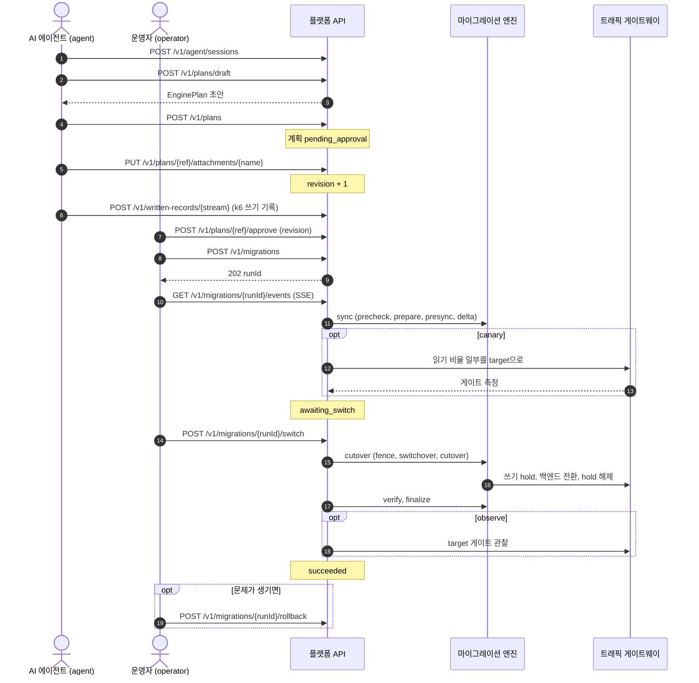
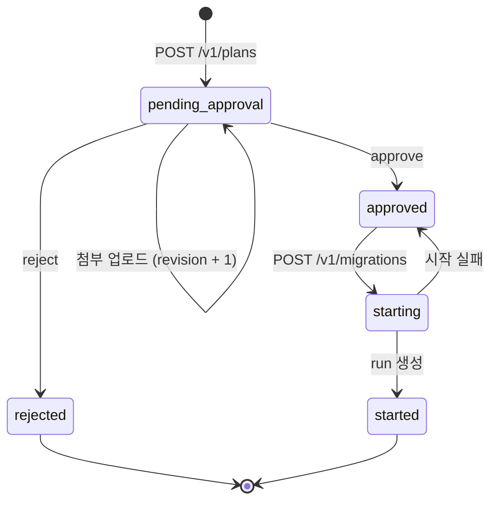
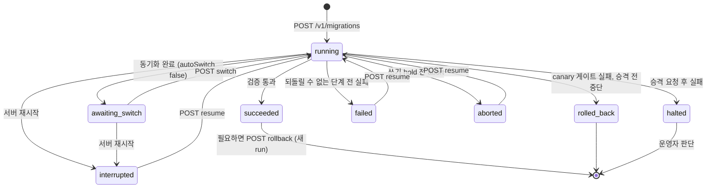
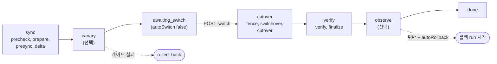
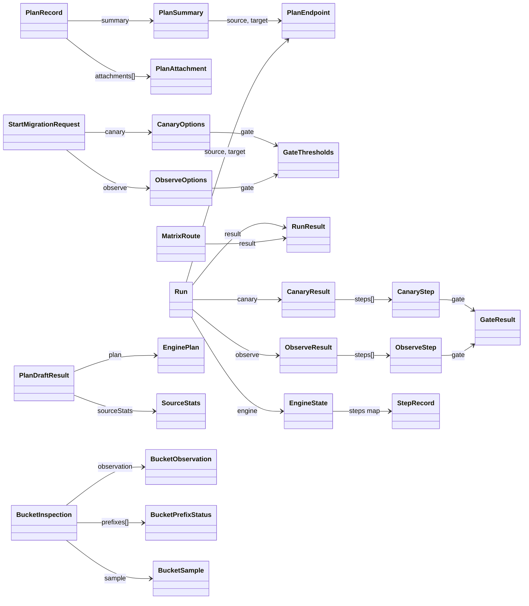
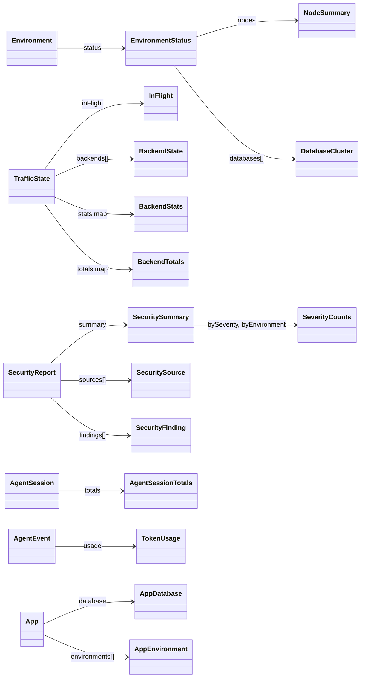
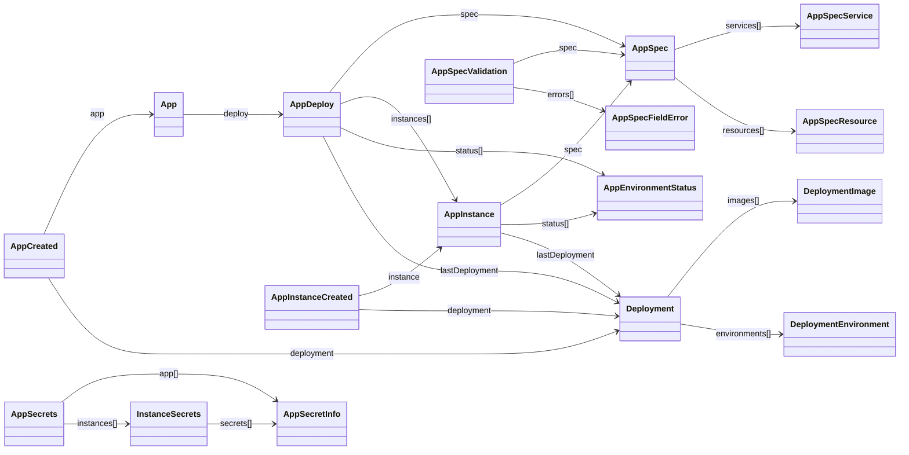

{{meta}}

이 페이지는 openapi.yaml을 표와 다이어그램으로 옮긴 것이다. 내용이 다르면 openapi.yaml이 기준이다.

platform 저장소의 `tools/apidoc`가 이 페이지를 만든다. 페이지를 직접 고치면 다음 갱신 때 사라지므로, 고칠 내용은 `tools/apidoc/apidoc.yaml`이나 `tools/apidoc/template.md`에 반영한다.

<table-of-contents />

## 개요

platform 서버, `charlie` CLI, 웹 콘솔이 이 계약 하나를 함께 쓴다. Go 타입은 `pkg/apiv1`로 생성하고, 콘솔은 `npx openapi-typescript`로 TypeScript 타입을 생성한다.

- 인증: `/v1` 요청은 모두 `Authorization: Bearer <token>` 헤더가 필요하다. 예외로 GitHub가 서명하는 GitHub App 웹훅(`POST /v1/webhooks/github`)과 `/v1/auth` 아래에서 역할이 인증 없음인 로그인 엔드포인트는 토큰 없이 호출한다. `/`, `/healthz`, `/openapi.yaml`도 인증 없이 호출한다.
- 오류: 모든 오류 응답은 `Error` 본문(`{"error": {"code", "message"}}`)을 쓴다.
- 실시간: run, 에이전트 세션, 배포의 진행은 SSE로 받는다. 브라우저에서는 fetch 기반 SSE 클라이언트를 쓴다.

### 토큰 역할

{{enum:Role:역할:할 수 있는 일}}

## 전체 흐름

AI 에이전트가 계획을 만들고, 운영자가 승인과 전환을 결정하는 순서다. 화살표 옆의 글자는 호출하는 API다.

## 상태 다이어그램

### 계획 (PlanStatus)

{{enum:PlanStatus:상태:의미}}

### run (RunStatus)

{{enum:RunStatus:상태:의미}}

### run 단계 (RunPhase)

{{enum:RunPhase:단계:내용}}

## 엔드포인트 한눈에 보기

모두 {{endpoint_count}}개다. 메서드 색은 GET 파랑, POST 초록, PUT 주황, DELETE 빨강이다.

{{endpoint_table}}

## 엔드포인트 상세

토글을 열면 파라미터, 요청 본문, 응답, 주의 사항이 나온다. 응답 본문 타입은 아래 '스키마' 절에 있다.

{{endpoint_details}}

## 스키마

### 관계도

주요 응답 타입이 어떤 타입을 포함하는지 보여 준다. 화살표 옆의 글자는 필드 이름이다.

{{schema_groups}}

### 열거형

{{enum_list}}

SecuritySourceStatus 값의 의미는 다음과 같다.

{{enum:SecuritySourceStatus:값:의미}}

## SSE 이벤트

### run 이벤트 스트림 (SSE event 이름)

`snapshot`을 제외한 이름은 RunEvent.kind 값이다.

| kind | 보내는 쪽 | data |
|---|---|---|
| `snapshot` | 플랫폼 | Run 전체. 처음과 마지막에 보내며 SSE id가 없다 |
| `step_started` | 엔진 |  |
| `step_succeeded` | 엔진 | `durationMillis` (integer), `evidence` (object) |
| `step_failed` | 엔진 |  |
| `step_skipped` | 엔진 |  |
| `log` | 엔진 |  |
| `metric` | 엔진 | 복제 지연 `lagBytes` (integer) 또는 쓰기 중단 시간 `downtimeMillis` (integer) |
| `rollback` | 엔진 |  |
| `halt` | 엔진 |  |
| `done` | 엔진 | `downtimeMillis` (integer) |
| `status_changed` | 플랫폼 | `status` (RunStatus), `phase` (RunPhase), `reason` (string, 비어 있을 수 있음) |
| `canary_step` | 플랫폼 | `weight` (integer, 0이면 읽기가 모두 source로 돌아감), `readWeights` (object) |
| `gate_result` | 플랫폼 | `weight` (integer), `gate` (GateResult) |
| `observe_step` | 플랫폼 | `verdict` (ok, violated, inconclusive), `gate` (GateResult) |
| `observe_rollback` | 플랫폼 | `rollbackRunId` (string) 또는 `error` (string). run이 끝난 뒤에 기록된다 |

data에는 표에 없는 키가 더 있을 수 있다.

### 에이전트 이벤트 스트림 (SSE event 이름)

`snapshot`을 제외한 이름은 AgentEvent.type 값이다.

| type | 용도 |
|---|---|
| `snapshot` | AgentSession 전체. 처음과 마지막에 보내며 SSE id가 없다 |
| `tool_call` | 도구 호출 (tool, input) |
| `tool_result` | 도구 결과 (tool, output, status) |
| `message` | 에이전트 메시지 |
| `blocked` | 정책으로 막힌 동작 (tool) |
| `decision` | 에이전트의 결정 |
| `error` | 오류 |

## 오류 코드

| HTTP | code | 상황 |
|---|---|---|
| `400` | invalid_request, invalid_plan, authorization_pending, access_denied, expired_token | 요청이나 계획이 형식, 정책에 맞지 않는다. 기기 로그인을 토큰으로 바꿀 때의 승인 대기, 거절, 만료도 400이다 |
| `401` | unauthorized, invalid_credentials, invalid_signature | 토큰이 없거나 틀렸다. 로그인의 아이디나 비밀번호, GitHub 웹훅 서명이 틀렸다 |
| `403` | forbidden, console_session_required, repo_not_imported | 토큰 역할로 할 수 없는 작업이거나, 콘솔 세션만 할 수 있는 작업이거나, push 토큰을 받을 수 없는 저장소다 |
| `404` | plan_not_found, run_not_found, env_not_found, attachment_not_found, agent_session_not_found, app_not_found, instance_not_found, deployment_not_found, device_login_not_found, secret_not_found, bucket_not_registered, prefix_not_listed, repo_not_found | 대상이 없다 |
| `409` | plan_state_conflict, run_state_conflict, cluster_busy, idempotency_key_reused, agent_session_finished, session_full, app_exists, app_not_registered, branch_exists, instance_exists, instance_limit, default_instance, residency_denied, capacity_insufficient, version_mismatch, device_login_state_conflict, nothing_to_redeploy, storage_cleanup_pending, deployment_in_progress | 대상의 현재 상태나 정책 때문에 할 수 없다 |
| `413` | too_large | 본문이 너무 크다 |
| `422` | invalid_app_spec | platform.yaml을 읽지 못했거나 규칙에 맞지 않는다. 본문은 AppSpecInvalid이고 validation에 위치가 나온다 |
| `429` | too_many_attempts | 로그인 시도나 승인 대기 중인 기기 로그인이 너무 많다. Retry-After의 초만큼 기다린 뒤 다시 시도한다 |
| `500` | internal | 예상하지 못한 오류. 자세한 내용은 서버 로그에만 남는다 |
| `502` | engine_init_failed, gateway_unreachable, github_unreachable, bucket_probe_failed | 엔진 초기화 실패, 게이트웨이나 GitHub 응답 없음, 버킷 측정 실패 |
| `503` | gateway_not_configured, security_not_configured, github_not_configured, login_not_configured, secrets_not_configured, storage_not_configured, residency_not_configured, audit_unavailable | 해당 기능이 서버에 설정되지 않았거나 감사 로그를 쓸 수 없다 |

